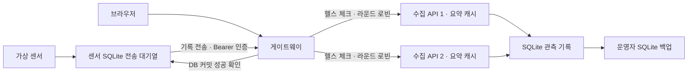

# 가마 온도 기록 복구

도예 실습에서 소성이 끝난 뒤 온도 곡선을 되짚어 보는 상황을 가정한다. 수집 서버가 멈춘 동안에도 가상 센서는 시각·온도·순번을 기록한다. 서버가 돌아오면 센서가 밀린 값을 전송하고, 같은 기록이 두 번 도착해도 DB에는 한 건만 남아야 한다.

## 설계 기준

1. **가용성 우선.** API 서버 한 대가 중단된 뒤 5초 내에 정상 응답을 관측하는 것이 목표다. 장애 구간이 끝나면 센서가 생성한 키와 DB에 남은 키를 전수 대조해 누락과 중복이 각각 0건인지 확인한다.
2. **성능·확장.** 같은 측정 기록을 건별 전송과 묶음 전송으로 재생한다. 생산량이 10배가 될 때 요청 수, 초당 저장 건수, 기록 생성부터 수신 확인까지의 p95 지연을 비교한다.
3. **범위.** 개인 Windows PC에서 실제 프로세스와 SQLite 저장소를 배포한다. 가마 온도는 합성 데이터다. 실습실 한 곳을 가정하며 가마 제어 명령이나 개인정보는 다루지 않는다.

## 처리 흐름



센서는 전송할 값을 먼저 디스크에 저장하고, 서버의 성공 응답을 받은 뒤 대기열에서 지운다. 서버는 가마 ID·소성 ID·순번의 조합으로 중복을 판정한다. 같은 키로 값이 달라지면 해당 묶음을 취소하고 409를 반환한다. 그래프는 서버 수신 시각 대신 센서 관측 시각을 사용한다.

두 수집기는 같은 PC와 DB를 공유한다. 이번 장애 실험의 대상은 수집 프로세스 한 대다. PC, 게이트웨이, DB 파일은 단일 장애 지점이다. 운영용으로 확장할 때는 호스트 분리, 외부 TLS, DB 복제와 호스트 밖 백업을 추가로 설계해야 한다.

## 실행

Windows 10 또는 11, Python 3.10 이상, Terraform 1.9 이상이 필요하다. 최초 `init`은 provider를 받아야 한다. 아래 명령은 프로젝트 루트에서 PowerShell로 실행한다.

```powershell
terraform -chdir=terraform init
terraform -chdir=terraform fmt -check -recursive
terraform -chdir=terraform validate
tflint --chdir=terraform
terraform -chdir=terraform plan '-out=local.tfplan'
terraform -chdir=terraform show -json local.tfplan | Set-Content -Encoding utf8 terraform/plan.json
python checks/plan_policy.py terraform/plan.json --negative-controls
terraform -chdir=terraform apply local.tfplan
```

브라우저에서 `http://localhost:18340/`을 열면 시드 데이터의 가마 6기와 온도 곡선을 볼 수 있다. 기본 구성은 수집기 2개, 요약 캐시 4초다. 포트와 수집기 수는 `terraform/terraform.tfvars.example`을 참고해 조정한다. 게이트웨이와 API 리스너 모두 루프백으로 제한한다. 운영 메트릭은 API의 로컬 포트에서 볼 수 있으며, 센서 자격 증명은 배포 시 제한된 권한의 파일로 생성한다.

## 시험 재현

- **S1.** 아래 명령을 수집기 1개와 2개 구성에서 각각 실행한다. 두 구성 모두 캐시를 0초로 설정한다. 시험은 프로젝트가 만든 `kiln-1`을 내렸다가 다시 시작하고, 원래 관측 시각과 저장 순번을 대조한다.
- **S2.** 수집기 2개와 캐시 0초에서 1기당 1건/초와 10건/초를 비교한다. 피크 부하는 같은 720개 기록으로 `--batch 1`과 `--batch 12`를 각각 시험한다. `--hz 0`은 밀린 기록을 한꺼번에 적재하는 별도 시험이다.
- **조회.** 동일한 데이터를 둔 상태로 캐시 0초와 4초를 비교한다. 20요청/초로 10초간 실행하고, 유효한 응답이 예정 시각부터 200ms 안에 도착한 비율이 99% 이상인지 확인한다. `--rate 0`은 처리량 확인용이다.
- **복구.** 정상 서비스가 동작하는 동안 체크포인트를 만들고 추가로 데이터를 쓴 뒤, 체크포인트를 별도 DB로 복원해 복구용 API와 원본 DB를 대조한다.

```powershell
python tests/experiment.py outage --label outage --out .runs/outage --ticks 60 --hz 10 --batch 12
python tests/experiment.py load --label peak --out .runs/peak --ticks 120 --hz 10 --batch 12
python tests/readload.py --rate 20 --seconds 10 --out .runs/read
python tests/recovery.py --out .runs/recovery
./checks/access_controls.ps1 -OutFile .runs/access.json
./checks/host_resources.ps1 -OutFile .runs/cost.json
```

각 실행의 출력 경로를 새 디렉터리로 지정한다. `terraform -chdir=terraform destroy`는 관리 중인 실습 프로세스와 서버 DB·백업을 삭제한다. 센서 대기열과 검증 결과는 `.runs/`에 남는다. 보존할 실제 데이터 대신 이 프로젝트가 생성한 실습 데이터로 실행한다.

## 저장소

[hprays/kiln-telemetry](https://github.com/hprays/kiln-telemetry)
