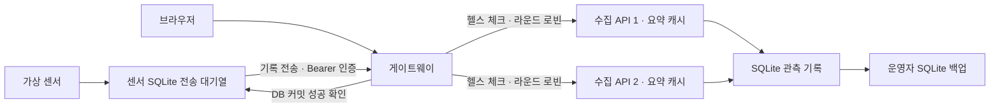

# 가마 온도 기록 복구

도예 실습에서 소성이 끝난 뒤 온도 곡선을 되짚어 보는 상황을 가정한다. 수집 서버가 멈춘 동안에도 가상 센서는 시각·온도·순번을 기록한다. 서버가 돌아오면 센서가 밀린 값을 전송하고, 같은 기록이 두 번 도착해도 DB에는 한 건만 남아야 한다.

## 설계 기준

1. **가용성 우선.** API 서버 한 대가 중단된 뒤 5초 내에 정상 응답을 관측하는 것이 목표다. 장애 구간이 끝나면 센서가 생성한 키와 DB에 남은 키를 전수 대조해 누락과 중복이 각각 0건인지 확인한다.
2. **성능·확장.** 같은 측정 기록을 건별 전송과 묶음 전송으로 재생한다. 생산량이 10배가 될 때 요청 수, 초당 저장 건수, 기록 생성부터 수신 확인까지의 p95 지연을 비교한다.
3. **범위.** 개인 Windows PC에서 실제 프로세스와 SQLite 저장소를 배포한다. 가마 온도는 합성 데이터다. 실습실 한 곳을 가정하며 가마 제어 명령이나 개인정보는 다루지 않는다.

## 처리 흐름



센서는 전송할 값을 먼저 디스크에 저장하고, 서버의 성공 응답을 받은 뒤 대기열에서 지운다. 서버는 가마 ID·소성 ID·순번의 조합으로 중복을 판정한다. 같은 키로 값이 달라지면 해당 묶음을 취소하고 409를 반환한다. 그래프는 서버 수신 시각 대신 센서 관측 시각을 사용한다.

두 수집기는 같은 PC와 DB를 공유한다. 이번 장애 실험의 대상은 수집 프로세스 한 대다. PC, 게이트웨이, DB 파일은 단일 장애 지점이다. 운영용으로 확장할 때는 호스트 분리, 외부 TLS, DB 복제와 호스트 밖 백업을 추가로 설계해야 한다.

## 시험에서 확인한 수치

| 항목 | 실측 |
|---|---|
| 수집기 장애 | 1대 구성은 중단 중 정상 조회 0/27건. 2대 구성은 26/26건이었으며, 중단 확인 후 첫 정상 응답은 0.078초에 관측했다. 두 시험 모두 360건 중 최종 누락·중복은 0건이다. [S1 기록](scenarios/S1.md) |
| 센서 부하 10배 | 같은 720건에서 건별 720회 요청과 p95 30.04초, 묶음 60회 요청과 p95 0.196초를 관측했다. p95는 생성부터 센서가 성공을 기록한 시점까지다. [S2 기록](scenarios/S2.md) |
| 조회 사용자 1명 → 10명 | 초당 2회에서 20회로 늘리자 캐시 없는 DB 요약 집계가 20회에서 200회로 늘었다. 10명에서 캐시를 4초로 설정하면 DB 집계는 4회, p95는 71.6ms에서 44.9ms로 줄었다. 두 10명 조건 모두 200건 전부 200ms 이내에 응답했다. [사용자별 측정](scenarios/S2.md) |
| 조회 캐시 | 초당 20요청에서 p95 114.9ms → 53.3ms. 캐시 4초에서 적중률 98%, 전체 집계 4/200회. 두 구성에서 200ms 기준을 충족한 유효 조회는 각각 200/200건이다. [캐시 사용 원자료](evidence/read-cache/summary.json) |
| 격리 백업 복구 | 체크포인트 6,579건과 SHA-256 일치. 격리 복구 API 검증까지 0.820초, 체크포인트 최신 기록과 장애 선언의 차이 1.577초. 체크포인트 후 6건은 복구본의 경계 밖이다. [복구 원자료](evidence/recovery/summary.json) |
| Terraform 재현성 | 자원 6개 삭제 후 state, 관리 디렉터리, 리스너가 비었음을 확인했다. 동일 코드로 6개를 다시 생성했고, 수집기 간 재전송과 충돌 검사를 통과했다. 다음 plan에서 변경은 0개였다. [삭제 검사](evidence/teardown-check.json) · [재생성 검사](evidence/recreate-check.json) · [마지막 plan](evidence/steady-plan.json) |

가용성과 처리량은 개인 PC 한 대에서 짧게 관측한 값이다. 조회 시험은 요청을 동시에 6개 보내는 폐루프에서 초당 61.34건과 318.93건을 각각 관측했다. 캐시 효과는 신규 쓰기가 멈춘 조건에서 측정했다. [캐시 없음](evidence/capacity-no-cache/summary.json) · [캐시 4초](evidence/capacity-cache/summary.json)

## 실행

Windows 10 또는 11, Python 3.10 이상, Terraform 1.9 이상 2.0 미만이 필요하다. 정적 분석에는 TFLint를 사용한다. 최초 `init`은 provider를 받아야 한다. 아래 명령은 프로젝트 루트에서 PowerShell로 실행한다. [도구 버전과 배포처](THIRD_PARTY.md)

```powershell
terraform -chdir=terraform init
terraform -chdir=terraform fmt -check -recursive
terraform -chdir=terraform validate
tflint --chdir=terraform
terraform -chdir=terraform plan '-out=local.tfplan'
terraform -chdir=terraform show -json local.tfplan | Set-Content -Encoding utf8 terraform/plan.json
python checks/plan_policy.py terraform/plan.json --negative-controls
terraform -chdir=terraform apply local.tfplan
```

브라우저에서 `http://127.0.0.1:18340/`을 열면 시드 데이터의 가마 6기와 온도 곡선을 볼 수 있다. 기본 구성은 수집기 2개, 요약 캐시 4초다. 포트와 수집기 수는 `terraform/terraform.tfvars.example`을 참고해 조정한다. 게이트웨이와 API 리스너 모두 루프백으로 제한한다. 운영 메트릭은 API의 로컬 포트에서 볼 수 있으며, 센서 자격 증명은 배포 시 제한된 권한의 파일로 생성한다.

Windows에서 배포 ZIP을 한글과 공백이 들어간 새 경로에 풀고 위 과정을 확인했다. 기존 배포와 동시에 실행하려고 포트만 18470으로 바꿨다. 자원 6개 생성, 웹 응답, 수집기 간 중복 처리, 후속 계획의 변경 0개, 실험 자원 삭제까지 확인했다. 검증한 ZIP의 커밋과 SHA-256은 실행 기록에 있다. [새 폴더 배포 기록](evidence/clean-install.json)

[온도 대시보드 캡처](evidence/captures/dashboard.png) · [정적 분석 캡처](evidence/captures/static.png) · [장애·부하 비교 캡처](evidence/captures/scenarios.png)

## 시험 재현

- **S1.** 아래 명령을 수집기 1개와 2개 구성에서 각각 실행한다. 두 구성 모두 캐시를 0초로 설정한다. 시험은 프로젝트가 만든 `kiln-1`을 내렸다가 다시 시작하고, 원래 관측 시각과 저장 순번을 대조한다.
- **S2.** 수집기 2개와 캐시 0초에서 1기당 1건/초와 10건/초를 비교한다. 피크 부하는 같은 720개 기록으로 `--batch 1`과 `--batch 12`를 각각 시험한다. `--hz 0`은 밀린 기록을 한꺼번에 적재하는 별도 시험이다.
- **조회.** 동일한 데이터를 둔 상태로 캐시 0초와 4초를 비교한다. 20요청/초로 10초간 실행하고, 유효한 응답이 예정 시각부터 200ms 안에 도착한 비율이 99% 이상인지 확인한다. `--rate 0`은 처리량 확인용이다.
- **사용자 증가.** 같은 데이터에 수집기 2개를 두고 캐시 0초에서 가상 사용자 1명과 10명을 시험한다. 캐시 4초에서 10명을 다시 시험한다. 아래 명령에서 `--viewers`와 출력 폴더를 조건에 맞춰 변경한다.
- **복구.** 정상 서비스가 동작하는 동안 체크포인트를 만들고 추가로 데이터를 쓴 뒤, 체크포인트를 별도 DB로 복원해 복구용 API와 원본 DB를 대조한다.

```powershell
python tests/experiment.py outage --label outage --out .runs/outage --ticks 60 --hz 10 --batch 12
python tests/experiment.py load --label peak --out .runs/peak --ticks 120 --hz 10 --batch 12
python tests/readload.py --rate 20 --seconds 10 --out .runs/read
python tests/viewer_growth.py --viewers 10 --out .runs/viewers-ten
python tests/recovery.py --out .runs/recovery
./checks/access_controls.ps1 -OutFile .runs/access.json
./checks/host_resources.ps1 -OutFile .runs/cost.json
```

각 실행의 출력 경로를 새 디렉터리로 지정한다. `terraform -chdir=terraform destroy`는 관리 중인 실습 프로세스와 서버 DB·백업을 삭제한다. 센서 대기열과 검증 결과는 `.runs/`에 남는다. 보존할 실제 데이터 대신 이 프로젝트가 생성한 실습 데이터로 실행한다.

**보안 검사.** 리스너 소유자와 바인딩, 인증 파일 접근권한, 읽기·쓰기 경로 등 12개 검사를 통과했다. TFLint 0.55.1의 검사 결과는 이슈 0건, 오류 0건이었다. 초기 계획에서 API 환경값이 배포 전까지 미확정으로 남아 자체 정책 검사가 실패했다. 인증정보 교체 의존성을 Terraform의 `replace_triggered_by`로 옮긴 뒤 정상 계획과 위반 대조군 두 개를 다시 검사했다. [실행 중 접근 제어](evidence/access-controls.json) · [정적 분석](evidence/base-static.json) · [계획 정책 검사](evidence/recreate-plan.json)

**자원·비용.** 수집기 2개와 게이트웨이의 합산 메모리 표본 최댓값은 79.29MiB, 전체 논리 프로세서 기준 평균 CPU는 0.94%였다. 8초간 80건을 실제 IPv4 리스너에서 조회해 모두 성공했다. 앞서 `localhost`를 사용한 두 번의 자원 측정에서는 각각 1건과 40건이 실패했다. 주소를 바꾼 뒤의 결과를 별도로 보존했다. [최초 측정](evidence/host-resources.json) · [시간 초과 재측정](evidence/host-resources-confirmation.json) · [IPv4 측정](evidence/host-resources-ipv4.json)

로컬 실험의 별도 클라우드 이용료는 0원이다. PC 추가 전력 18W, 하루 8시간, 월 22일, 200원/kWh, 월 활성 사용자 60명을 넣은 예산 모델은 월 3.168kWh, 634원, 1인당 약 11원이다. 전력 및 단가는 가정값이고, 하드웨어 감가와 운영 인건비는 제외했다.

## 저장소

[hprays/kiln-telemetry](https://github.com/hprays/kiln-telemetry)
