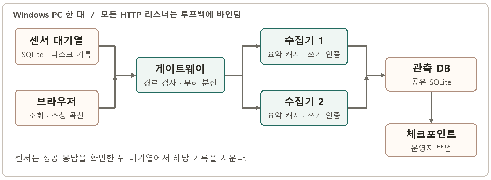
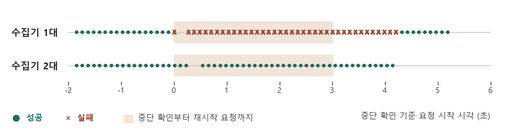
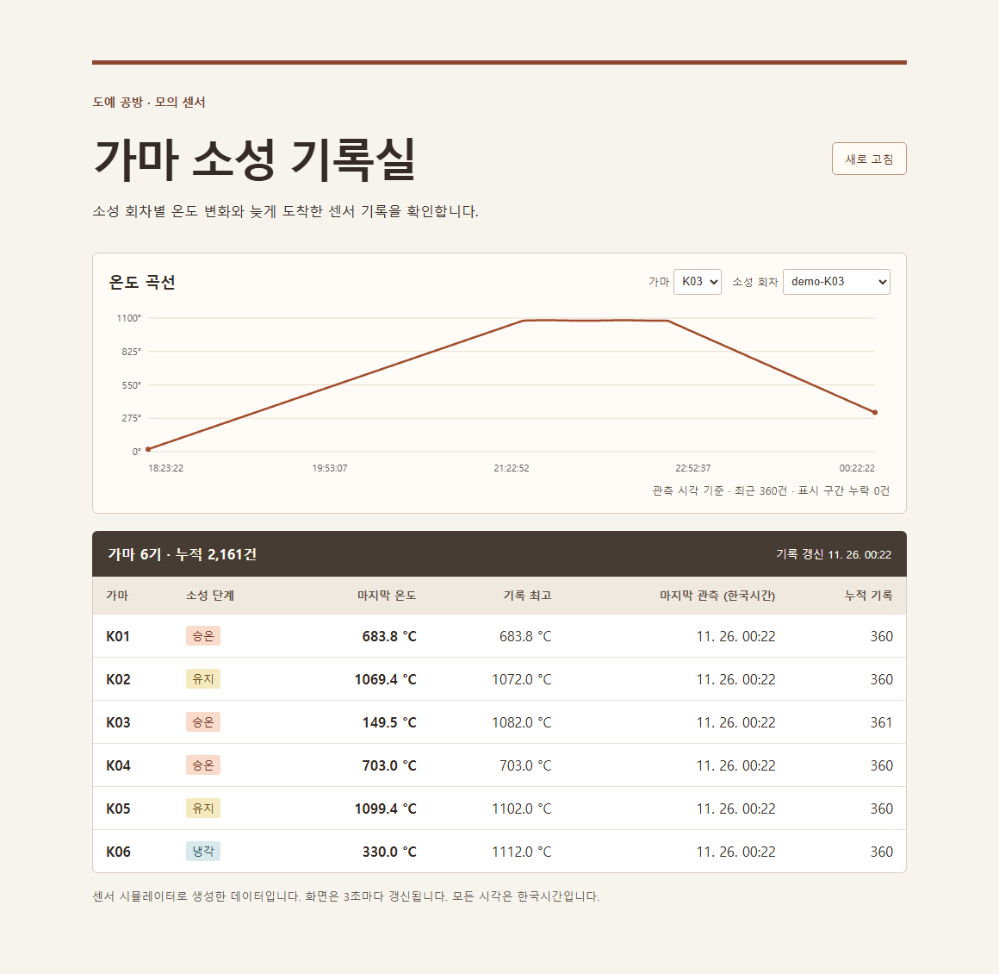
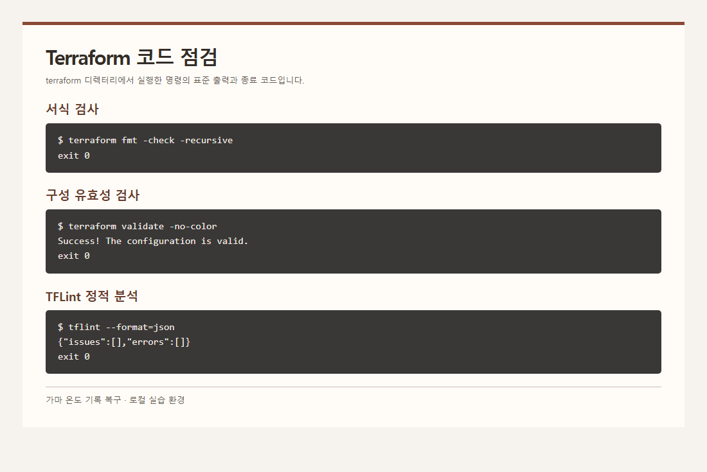
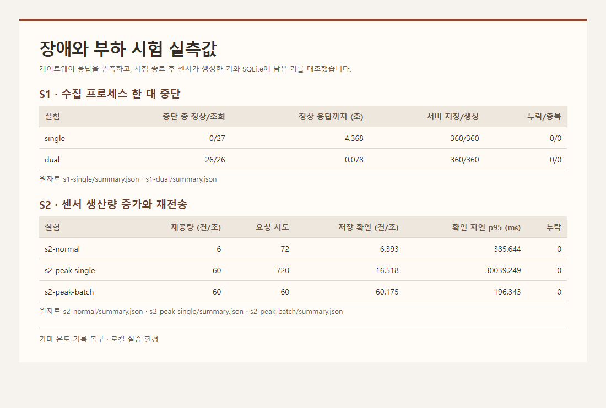

# 가마 온도 기록 복구 서비스

인프라 설계 및 구축 · 2026학년도 2학기 최종 과제 · hprays

## 1. 소성 기록에서 지켜야 할 것

가마가 식은 뒤 담당자가 확인할 수 있는 것은 온도 기록뿐이다. 센서가 통신을 재개한 시각을 그래프에 찍으면 실제로 온도가 떨어진 시점을 잘못 읽게 된다. 이 서비스는 늦게 도착한 값도 관측 시각에 배치한다. 같은 값을 두 번 받으면 한 점만 남긴다. 담당자는 소성 회차를 골라 곡선을 확인하고 수강생은 같은 화면을 조회한다.

### 우선순위와 합격 조건

| 우선순위 | 판단 기준 | 실험 결과 |
|---|---|---|
| 1. 가용성 | 수집기 하나를 중단한 뒤 5초 안에 정상 조회 | 수집기 2대에서 0.078초 |
| 1. 기록 보존 | 장애 후 생성 키와 저장 키의 누락·중복 각각 0건 | 360건 전수 대조에서 각각 0건 |
| 2. 성능·확장 | 초당 20회 조회에서 200ms 이내 유효 응답 99% 이상 | 캐시 4초에서 200/200건 |

수집기 응답이 끊겨도 센서가 기록을 버리지 않는 것이 첫 번째 조건이다. 응답이 조금 늦어지는 것은 허용했다. 조회에는 별도 목표를 두었다. 전송 대기열이 기록을 지켜도 수강생 화면은 열리지 않을 수 있기 때문이다.

### 실험 규모

실습실 한 곳에 가마 6기가 있고 소성 한 번이 6시간 걸린다고 가정했다. 매분 한 번씩 측정하면 가마당 360건이다. 새 배포에는 2160건을 넣었다. 부하 시험에서는 시간을 압축해 평시 초당 6건과 피크 초당 60건을 재생했다. 화면 조회는 사용자 1명과 10명으로 나눴다. 이 숫자는 수업 상황을 재현하기 위한 입력값이다.

온도와 센서는 모의 데이터다. HTTP 통신과 디스크 기록은 Windows PC에서 실행했다. 가마의 발열 장치나 제어기는 과제 범위 밖이다.

근거 · [초기 데이터 생성](../app/storage.py) · [장애 시험 원자료](../evidence/s1-dual/summary.json) · [조회 목표 검증](../evidence/read-cache/summary.json)

## 2. 수집기는 둘이고 저장소는 하나다

센서와 브라우저는 같은 게이트웨이에 접속한다. 게이트웨이는 응답할 수 있는 수집기 목록을 유지하고 요청을 번갈아 보낸다. 두 수집기가 같은 DB에 쓰므로 첫 번째 수집기가 처리한 기록을 두 번째 수집기도 중복으로 알아볼 수 있다.



### 설계에서 선택한 비용

| 선택 | 얻은 효과 | 남은 제약 |
|---|---|---|
| 수집기 2개 | 한 프로세스가 중단돼도 다른 수집기로 조회 가능 | 같은 PC의 전원과 운영체제를 공유 |
| 공유 SQLite | 별도 DB 서버 없이 두 수집기에 동일한 키 제약 적용 | 쓰기는 한 DB에 모임 |
| 수집기별 요약 캐시 | 별도 캐시 서버 없이 반복되는 전체 집계를 줄임 | 수집기별 캐시를 채워야 하고 쓰기가 잦으면 재집계 |
| 디스크 전송 대기열 | 송신 프로세스가 끝나도 미확인 기록 보존 | 대기 시간이 길어지면 화면에 최신 온도가 늦게 반영 |

Docker Desktop을 실행할 수 없는 환경에서 Terraform Shell Provider로 Windows 프로세스와 저장 디렉터리를 관리했다. 이 구성은 수집기 하나의 고장을 시험하기에 충분했다. 게이트웨이와 주 DB는 각각 하나이고 백업도 같은 디스크에 있다. PC 전체의 장애를 견디려면 다른 호스트에 복제본과 백업을 두고 전환을 별도로 시험해야 한다.

근거 · [Terraform 자원 정의](../terraform/main.tf) · [프로세스 수명 주기](../ops/lifecycle.py) · [게이트웨이 라우팅](../app/gateway.py)

## 3. 늦은 기록과 중복 기록의 처리

> 관측 → 센서 디스크에 기록 → 인증된 묶음 전송 → 수집기 DB 커밋 → 센서가 성공 응답 확인 → 대기열에서 삭제

센서는 전송에 앞서 가마 ID와 소성 ID와 순번을 온도·관측 시각과 함께 저장한다. 수집기는 앞의 세 필드를 복합 기본키로 사용한다. 같은 묶음 안에서 충돌이 생기면 그 묶음의 쓰기를 모두 취소한다. 센서는 응답의 신규 건수와 중복 건수 합계가 보낸 건수와 맞을 때만 대기열을 비운다.

| 새 배포에서 보낸 요청 | HTTP | DB에 남은 결과 |
|---|---:|---|
| 첫 수집기에 K03의 새 기록 전송 | 201 | 149.5°C 한 건 |
| 다른 수집기에 같은 키와 같은 값 전송 | 200 | 중복 한 건으로 응답. 저장 건수 유지 |
| 같은 키의 온도를 150°C로 바꿔 전송 | 409 | 처음 저장한 149.5°C 유지 |

### 읽기 경로

> 브라우저 → 게이트웨이 → 요약 또는 회차별 곡선 → 관측 시각 순으로 화면에 표시

목록은 가마별 최신 온도와 최고 온도 및 누적 건수를 보여 준다. 곡선은 선택한 회차의 관측 시각을 기준으로 최대 720점을 반환한다. 센서가 과거 기록을 다시 보내도 그 값은 원래 시각에 들어간다. S1에서는 K03의 60개 점을 원본 순번·시각·온도와 비교해 모두 일치하는지 확인했다.

장애 중 데이터 보존과 복구 후 정합성은 따로 검사했다. 성공 응답 직후 센서의 확인 처리를 한 번 생략하자 같은 12건이 다시 전송됐다. 수집기는 12건 전부를 중복으로 인식했다. 이 절차 덕분에 응답 건수만 세어서는 드러나지 않는 중복 저장도 확인할 수 있었다.

근거 · [센서 대기열](../tests/sensor.py) · [DB 키와 입력 검증](../app/storage.py) · [교차 수집기 시험](../evidence/recreate-check.json)

## 4. Terraform 배포와 재현

Terraform 1.13.5와 Shell Provider 1.7.10을 사용했다. 저장소와 백업 디렉터리와 센서 자격 증명을 먼저 만든다. 이후 수집기 두 개를 시작하고 마지막으로 게이트웨이를 연결한다. Terraform 상태에서 기본 구성은 자원 6개다.

> 초기화 → 서식·유효성·정적 검사 → 계획 저장 → 정책 검사 → 변경 확인 → 적용 → 웹 조회와 쓰기 검증

### 재현 절차

Windows에서 Python 3.10 이상과 Terraform 및 TFLint를 준비한 뒤 프로젝트 루트에서 실행한다. 기본 게이트웨이 포트는 18340이고 수집기는 그다음 두 포트를 사용한다. 아래 명령의 계획을 확인한 뒤 같은 계획 파일을 적용한다.

```powershell
terraform -chdir=terraform init
terraform -chdir=terraform fmt -check -recursive
terraform -chdir=terraform validate
tflint --chdir=terraform
terraform -chdir=terraform plan '-out=local.tfplan'
terraform -chdir=terraform show -json local.tfplan |
  Set-Content -Encoding utf8 terraform/plan.json
python checks/plan_policy.py terraform/plan.json --negative-controls
terraform -chdir=terraform show local.tfplan
terraform -chdir=terraform apply local.tfplan
```

| 확인 시점 | 관측 결과 |
|---|---|
| 기존 배포 삭제 | 자원 6개 삭제. 관리 디렉터리 제거와 리스너 종료 확인 |
| 같은 코드로 재생성 | 자원 6개 생성. 가마 6기와 시드 2160건으로 시작 |
| 재생성 후 계획 | 자원 6개 모두 변경 없음 |
| ZIP을 새 경로에 풀어 설치 | 한글·공백 경로에서 기존 상태 없이 초기화. 웹 응답 200과 중복 처리 확인 |

수집기 수와 포트 및 캐시 시간은 변수로 분리했다. 저장소에는 예시 입력과 provider 잠금 파일을 둔다. 실습을 정리할 때 `terraform -chdir=terraform destroy`는 관리 DB와 백업도 삭제하므로 보존할 기록은 먼저 옮겨야 한다.

근거 · [삭제 검사](../evidence/teardown-check.json) · [재생성 결과](../evidence/recreate-apply.json) · [후속 계획](../evidence/steady-plan.json) · [새 설치](../evidence/clean-install.json)

## 5. S1 장애 — 수집기 하나가 멈췄을 때

가마 6기가 초당 10건씩 보내는 동안 첫 수집기를 종료했다. 수집기 1대와 2대를 같은 조건으로 비교했다. 캐시는 껐고 센서는 최대 12건을 묶어 보냈다. 중단 확인 후 약 3초가 지났을 때 수집기를 재시작했다.

> 수집기 종료 → 게이트웨이 조회와 센서 대기열 관측 → 수집기 재시작 → 미확인 기록 재전송 → 저장 키 전수 검사



| 지표 | 수집기 1대 | 수집기 2대 |
|---|---:|---:|
| 중단 중 정상 조회 | 0/27건 | 26/26건 |
| 중단 확인 후 첫 정상 조회 | 4.368초 | 0.078초 |
| 전체 시험의 정상 조회 | 26/64건 | 54/54건 |
| 최대 관측 대기열 | 252건 | 30건 |
| 최종 저장 / 생성 | 360/360건 | 360/360건 |

11월 26일 00:09에 수집기 한 대를 멈추자 조회할 대상이 사라졌다. 00:10에는 Terraform 변수 `replicas`로 증설한 구성에서 같은 장애를 주었다. 이때 중단 중 성공한 응답은 모두 두 번째 수집기에서 왔다. 두 시험의 최종 누락과 중복은 각각 0건이었다.

한 대 구성도 재시작 후에는 5초 안에 응답했지만 중단 중 성공한 조회가 한 건도 없었다. 따라서 5초 기준과 중단 구간 성공률을 함께 기록했다. 조회 간격은 약 100ms다. 0.078초는 중단을 확인한 시각부터 첫 정상 응답을 관측할 때까지의 시간이다. 운영 중에는 정상 수집기 수와 가장 오래 대기 중인 센서 기록의 나이를 같이 감시할 필요가 있다.

근거 · [수집기 1대](../evidence/s1-single/summary.json) · [수집기 2대](../evidence/s1-dual/summary.json) · [분 단위 타임라인](../scenarios/S1.md)

## 6. S2 성장 — 기록이 쌓이는 속도

가마 수는 6기로 유지하고 가마당 생성량을 초당 1건에서 10건으로 늘렸다. 시험마다 수집기 두 개와 캐시 0초를 유지했다. 피크 비교에는 같은 온도와 순번을 갖는 720건을 사용했다. 지연은 기록이 생성된 때부터 센서가 성공 응답을 대기열에 반영한 때까지 측정했다.

> 생산량 10배 → 건별 전송 지연 관측 → 최대 12건 묶음 적용 → 같은 입력 재생 → DB 키와 확인 지연 비교

| 조건 | 생성 / 저장 | POST 시도 | 확인 처리량 | 확인 지연 p95 |
|---|---:|---:|---:|---:|
| 평시 · 건별 | 72/72 | 72회 | 6.39건/초 | 386ms |
| 피크 · 건별 | 720/720 | 720회 | 16.52건/초 | 30.039초 |
| 피크 · 묶음 | 720/720 | 60회 | 60.18건/초 | 196ms |

00:10부터 평시와 피크를 차례로 시험했다. 건별 전송은 생성 속도를 따라가지 못했다. 한 건마다 HTTP 왕복과 DB 커밋 및 대기열 확인이 반복됐다. 00:11에 묶음 전송을 적용하자 요청은 12분의 1로 줄었다. 저부하에서 묶음이 다 찰 때까지 기다리지 않도록 전송 대기 상한을 200ms로 두었다.

### 35초 뒤 남은 351건

840건을 한꺼번에 넣은 별도 시험은 35초 안에 끝나지 않았다. 그 시점의 서버에는 489건이 있었고 센서 대기열에는 351건이 남았다. 00:21에 새 송신 프로세스가 원래 대기열을 열었다. 30회 요청과 1.511초 뒤 대기열은 비었다. 최초 소성 ID로 다시 조회한 결과 840개 키가 한 번씩 저장돼 있었다.

운영 경보는 HTTP 오류율 외에 대기열의 길이와 체류 시간을 봐야 한다. 건별 전송은 최종 누락이 없어도 수강생이 수십 초 전의 온도를 보게 만들었다.

근거 · [피크 건별](../evidence/s2-peak-single/summary.json) · [피크 묶음](../evidence/s2-peak-batch/summary.json) · [35초 시점](../evidence/s2-drain-35s-limit/summary.json) · [재전송 결과](../evidence/s2-replay.json)

## 7. 사용자 열 명이 같은 화면을 볼 때

한 명이 보던 요약을 열 명이 동시에 조회하도록 했다. 각 가상 사용자는 10초 동안 초당 두 번 요청했다. 실제 화면의 기본 갱신 주기는 3초다. 시험 중에는 새 기록을 쓰지 않았고 매번 가마 6기와 누적 건수가 들어 있는 유효한 응답인지 확인했다.

| 가상 사용자 | 캐시 TTL | 요청 | DB 전체 집계 | 예정 시각 기준 p95 |
|---|---:|---:|---:|---:|
| 1명 | 0초 | 20건 | 20회 | 65.2ms |
| 10명 | 0초 | 200건 | 200회 | 71.6ms |
| 10명 | 4초 | 200건 | 4회 | 44.9ms |

00:31에 기본 구성인 캐시 4초에서 열 명을 측정했다. 00:32에 Terraform으로 TTL을 0초로 바꾼 뒤 한 명과 열 명을 차례로 측정했다. 세 조건 모두 예정 시각부터 200ms 안에 유효 응답을 받았다. 열 명 조건에서 캐시로 줄어든 것은 비용이 큰 요약 집계 196회다. 적중 때도 DB 리비전은 확인한다. 새 쓰기가 발생하면 TTL이 남아 있어도 다음 조회에서 다시 집계한다.

### 같은 부하에서 보는 지연과 처리 용량

독립 사용자 시험과 별도로 초당 20회 요청을 예약한 시험에서는 캐시 0초의 p95가 114.9ms였고 4초에서는 53.3ms였다. SLO의 분자는 **200ms 안에 도착한 유효 응답 수**이고 분모는 전체 예정 요청 수다. 두 조건 모두 200건 중 200건으로 목표 99%를 충족했다.

동시 작업 6개가 응답을 받는 즉시 다시 요청하는 8초 시험에서는 초당 61.34건과 318.93건을 관측했다. 이는 해당 PC와 데이터에서 관측한 처리량이다. 입력이 멈춘 짧은 시험이므로 계속 쓰는 환경의 장기 용량이나 월간 가용률은 별도 검증이 필요하다.

근거 · [사용자 10명 원자료](../evidence/viewers-ten-cached/summary.json) · [조회 SLO](../evidence/read-cache/summary.json) · [기준 처리량](../evidence/capacity-no-cache/summary.json) · [캐시 처리량](../evidence/capacity-cache/summary.json)

## 8. 접근 제어와 배포 전 검사

대시보드는 인증 없이 조회할 수 있고 기록 쓰기는 배포 시 발급한 센서 자격 증명이 필요하다. 자격 증명은 Windows 접근 제어가 적용된 로컬 파일에 둔다. 게이트웨이는 허용된 경로만 전달한다. 운영자가 수집기 메트릭을 읽는 경로와 화면 조회 경로를 분리했다.

| 나눈 경계 | 실제 검사 | 결과 |
|---|---|---|
| 리스너 | 게이트웨이와 두 수집기의 바인딩·소유 프로세스 확인 | 모두 루프백. 기록한 PID와 일치 |
| 파일 | 센서 파일과 관리 디렉터리의 Windows 접근 권한 확인 | 설정한 계정 범위와 일치 |
| 운영 메트릭 | 게이트웨이와 수집기 포트에 같은 경로 요청 | 각각 403과 200 |
| 쓰기 | 자격 증명 없음 / 잘못된 자격 증명 / 인증된 빈 묶음 | 각각 401 / 401 / 422 |

IPv4 리스너에서 12개 검사 모두 통과했다. 같은 PC에 로그인한 사용자는 수집기 포트에 직접 접근할 수 있다. 외부 공개 서비스로 바꿀 때는 운영 메트릭 인증과 별도 네트워크 경계 및 TLS가 필요하다.

### 정적 분석과 정책 검사

Terraform 서식 검사와 유효성 검사를 통과했다. TFLint 0.55.1의 이슈와 오류는 모두 0건이었다. 별도로 작성한 계획 정책은 루프백 바인딩과 포트 중복·범위 및 수집기 수 상한을 검사한다. 초기 구성에서는 배포 전에 API 환경값을 확정하지 못해 정책 검사가 실패했다. 인증 자원 교체 시 수집기도 교체하도록 `replace_triggered_by`로 의존성을 표현한 뒤 계획을 다시 검사했다.

정상 계획은 통과했다. 시험용으로 개방형 바인딩 또는 특권 포트를 넣은 계획은 두 건 모두 거부됐다. 제출 파일과 Git 이력은 시크릿 패턴과 로컬 센서 값으로 점검했다. 사용 도구의 버전과 출처는 저장소의 라이선스 목록에 기록했다.

근거 · [접근 제어 12건](../evidence/access-controls-ipv4.json) · [정책 대조군](../evidence/recreate-plan.json) · [정적 분석 출력](../evidence/captures/static-commands.json) · [라이선스와 출처](../THIRD_PARTY.md)

## 9. 어느 시점까지 복구됐는가

수집기 중단 실험에서는 원본 DB가 살아 있다. 백업의 효용은 별도로 시험했다. 원본에 가마별 표식 한 건씩을 쓴 뒤 작동 중인 SQLite에서 체크포인트를 만들었다. 이어 두 번째 표식 6건을 커밋했다. 장애를 선언한 뒤 체크포인트를 다른 DB에 복원하고 복구용 API를 시작했다.

> 첫 표식 6건 → 온라인 체크포인트 → 둘째 표식 6건 → 장애 선언 → 격리 복원 → API 응답과 전체 행 해시 대조

| 확인한 값 | 1차 격리 복구 | Terraform 관리 경로 재시험 |
|---|---:|---:|
| 체크포인트 / 복원 행 수 | 6579 / 6579 | 2167 / 2167 |
| 체크포인트 마지막 커밋과 장애 선언 간격 | 1.5765초 | 1.4963초 |
| 장애 선언 후 올바른 API 응답까지 | 0.8196초 | 0.8253초 |
| 체크포인트 후 원본에만 남은 행 | 6건 | 6건 |
| 체크포인트와 복원 데이터의 SHA-256 | 일치 | 일치 |

재시험에서는 Terraform이 만든 백업 디렉터리에 체크포인트를 저장했다. 복원본에는 첫 표식 6개만 있었고 원본에는 두 표식 12개가 모두 있었다. SQLite 무결성 검사도 통과했다. 행 수가 같아도 온도가 달라질 수 있으므로 정렬한 모든 관측 행의 해시까지 비교했다.

여기서 RPO는 장애를 선언한 시각과 복구 가능한 마지막 커밋의 차이다. RTO는 선언부터 복구 API가 올바른 리비전과 건수를 응답할 때까지다. 이번에 측정한 값에는 장애 탐지 시간과 기존 접속 주소를 바꾸는 시간이 들어 있지 않다. 한 디스크에 둔 체크포인트이므로 물리 디스크 고장에 대한 보장은 없다.

근거 · [복구 절차](../tests/recovery.py) · [1차 복구 원자료](../evidence/recovery/summary.json) · [관리 경로의 타임라인과 해시](../evidence/recovery-managed/summary.json)

## 10. 운영비와 적용 범위

기존 PC에서 실행해 실험의 별도 클라우드 이용료는 0원이다. 수집기 두 개와 게이트웨이의 자원 사용량은 실제 조회 중에 측정했다. 전력계가 없어 전기 사용량은 가정으로 계산했다.

| 항목 | 산정 방식 | 값 |
|---|---|---:|
| CPU | 세 프로세스의 CPU 시간 합 / (경과 시간 × 논리 코어 16개) | 평균 0.937% |
| 메모리 | 세 프로세스 작업 집합 합계의 표본 최댓값 | 79.293MiB |
| 월 전력 사용 | 추가 소비전력 18W × 하루 8시간 × 월 22일 | 3.168kWh |
| 월 전기료 | 3.168kWh × 가정 단가 200원/kWh | 633.6원 |
| 이용자당 월 전기료 | 월 3개 반 × 반당 20명 | 10.56원 |

월 비용에는 장비 감가와 운영 인건비 및 외부 백업 비용을 포함하지 않았다. 같은 PC에서는 조회 사용자가 열 배가 돼도 건별 클라우드 청구가 발생하지 않는다. 반면 집계 횟수에 비용을 매기는 서비스를 쓴다면 10초간 20회였던 전체 집계가 200회로 늘 때 이 항목의 비용도 열 배가 된다. 같은 피크에서 캐시를 적용한 관측값은 4회였다.

### 회고

실습실에서 먼저 볼 지표는 가마 한 기의 마지막 관측 시각과 아직 전송하지 못한 기록의 나이다. 건별 전송에서도 720건은 모두 저장됐지만 피크의 p95 확인 지연은 30초였다. 데이터 보존 여부만 보면 놓치는 문제다. 여러 공방으로 확대한다면 공방별 쓰기 권한과 호스트 밖 백업을 먼저 마련하고 실제 접속 주소로 복구하는 시간을 측정할 필요가 있다.

Codex를 주제 비교와 코드 작성 및 시험 실행에 사용했고 보고서와 AI 활용 기록의 초안도 작성하도록 했다. 실패한 최초 자원 측정과 캐시 설명 오류는 원자료와 코드로 다시 확인했다. 수집 장애·부하 시험 8회의 p95와 요청 수는 CSV에서 재계산했다. 작업 범위와 수정 근거는 AI 활용 기록에 남겼다.

근거 · [자원·비용 원자료](../evidence/host-resources-ipv4.json) · [CSV 재계산 코드](../checks/recorded_trials.py) · [AI 활용 기록](../ai-log.md) · [공개 저장소](https://github.com/hprays/kiln-telemetry)

## 부록 A. 온도 기록 화면

재배포 직후 K03의 모의 소성 회차를 선택한 화면이다. 표의 누적 기록은 2161건이다. 초기 2160건에 재배포 확인용 기록 한 건이 추가됐다. 선택한 회차의 온도 곡선은 별도로 표시한다.



근거 · [화면 캡처 원본](../evidence/captures/dashboard.png) · [재배포 확인 기록](../evidence/recreate-check.json)

## 부록 B. 정적 분석과 시나리오 증빙

첫 화면은 실행한 명령의 출력과 종료 코드다. 두 번째 화면은 장애·부하 시험 결과 파일에 기록된 수치다. 시나리오별 요청 로그는 해당 실험의 evidence 디렉터리에 함께 보관했다.





근거 · [명령 실행 기록](../evidence/captures/static-commands.json) · [수집기 중단 기록](../scenarios/S1.md) · [피크 부하 기록](../scenarios/S2.md)
